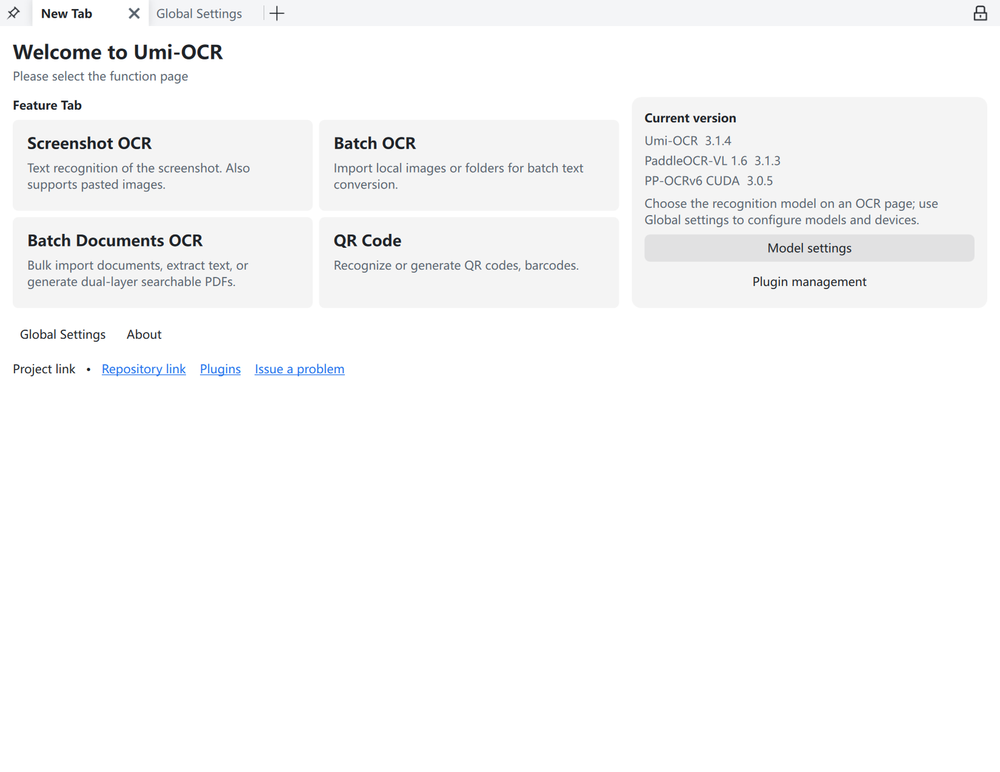

# Umi-OCR

[中文](README.md) · **English** · [日本語](README_ja.md)

Offline OCR for Windows 10/11 x64: image and PDF batches, screenshot OCR, QR/barcodes, Markdown results, CLI and HTTP APIs.

Maintained by [Dominic485649](https://github.com/Dominic485649), based on [hiroi-sora/Umi-OCR](https://github.com/hiroi-sora/Umi-OCR). Original attribution and [translation credits](docs/ACKNOWLEDGEMENTS.md) are retained.

## Interface and workflows



Task descriptions stay visible without hovering. Installed host/plugin versions are shown separately, with shortcuts to model settings and plugin management. Narrow windows use a vertical layout; keyboard focus, light/dark themes and text scaling are supported.

Use **Screenshot OCR** for pasted/local images as well as capture, **Batch OCR** for image folders, **Batch documents** for text extraction/searchable PDFs, and **QR codes** without an OCR plugin. PaddleVL structured parsing is available through the [HTTP document API](docs/http/api_document.md); its separate document-task UI remains hidden by default. [More real interface views and their scope](docs/UI_SHOWCASE.md).

## Download and install

Get the base application from [application Releases](https://github.com/Dominic485649/UMI-OCR/releases) and CUDA/PaddleVL from [plugin Releases](https://github.com/Dominic485649/UMI-OCR_plugins/releases). As checked on 2026-11-08, the published versions are application **3.1.3**, CUDA **3.0.5** and PaddleVL **3.1.3**, supplied as three independent runtime archives. The **3.1.4 local candidate** improves the task workbench and settings navigation; it is not a published release, and plugin versions do not change with the host. Use each Release's actual asset list and checksums.

1. Fully extract the base `.tar.xz` into a writable application directory.
2. Extract each desired plugin into **the same application root**, preserving its paths.
3. Run `Umi-OCR.exe`, then enable/select the backend in global settings → plugin management.

Plugins are installed in `UmiOCR-data/plugins/<plugin-id>/`. The base has no OCR inference plugin. Shut down normally before updating; retain user settings, logs, task assets and models. Never overwrite a running installation.

The minimal runtime packages omit separate source mirrors, source ZIPs, development docs and audit reports. They retain all required runtime files, HTTPS certificates and applicable license notices. Matching corresponding source is delivered separately; ordinary use does not require downloading it. See [source delivery](SOURCE-CODE.md).

Host API is 2.9; CUDA declares `>=2.7,<3.0`, PaddleVL `>=2.9,<3.0`. Python 3.13.16 and Qt 6.11.2 are bundled. No system Python or CUDA Toolkit is needed. Both OCR plugins require compatible NVIDIA hardware/drivers and provide no CPU fallback; PaddleVL targets Turing (sm75) and later. The interface, QR workflows and supported existing-text extraction remain usable without an OCR plugin.

## PaddleVL models

The main GGUF, visual projection GGUF and layout-model path rows provide a **Download** button to the left of the file picker. After confirmation, the app downloads pinned official PaddlePaddle files over HTTPS in the background, with progress and cancellation.

Files are installed in **the currently installed plugin's own `model/` directory**:

```text
<your installation>/UmiOCR-data/plugins/win32_PaddleOCRVL_1_6/model/
```

The official GGUF pair is approximately 1.69 GiB; PP-DocLayoutV3 is approximately 126 MiB and is needed for full document parsing. No alternate quantization is selected. Paths are filled only after complete size/hash/content checks. Existing conflicting files are not overwritten; write failures do not silently redirect the download elsewhere. Manual imports and existing external model paths remain supported. Nothing downloads automatically at startup.

PaddleVL document parsing is available through [HTTP](docs/http/api_document.md) by default; its document-task UI is not shown by default. Downloading a model does not enable or reconfigure HTTP.

## Guides and licensing

- [User guide](docs/USER_GUIDE.md) · [Model downloads](docs/MODEL_DOWNLOADS.md)
- [CLI](docs/README_CLI.md) · [HTTP](docs/http/README.md) · [Documentation index](docs/README.md)
- [Windows build guide](docs/BUILD_WINDOWS_CUDA_en.md) · [Plugin API](docs/PLUGIN_API.md)
- [Changelog](CHANGE_LOG.md) · [Historical records](docs/HISTORY.md)

Original Umi-OCR remains under its MIT [LICENSE](LICENSE). Fork additions/modifications and the combined PyMuPDF distribution are [AGPL-3.0-or-later](COPYING). Paid delivery or support does not restrict recipients' rights. Third-party runtimes and models retain their respective terms; no additional trademark/model authorization is claimed.

Capture, HDR and mixed/multiple-monitor validation remains **NOT_RUN**, not a pass inferred from unrelated tests. Other platforms are not built in this round.

[Issues](https://github.com/Dominic485649/UMI-OCR/issues) · [Support group](https://qm.qq.com/q/5XHoXCOU26)
