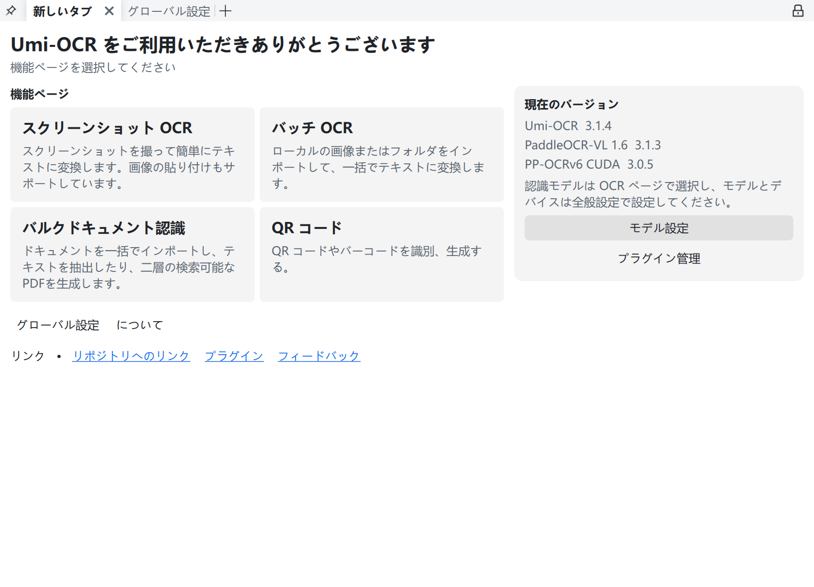

# Umi-OCR

[中文](README.md) · [English](README_en.md) · **日本語**

Windows 10/11 x64 向けのオフライン OCR ツールです。画像・PDF の一括認識、画面 OCR、QR コード、Markdown 出力、CLI、HTTP API に対応します。

本 fork の開発・保守は [Dominic485649](https://github.com/Dominic485649)、原作者は [hiroi-sora](https://github.com/hiroi-sora/Umi-OCR) です。元の著作権表示と[翻訳への貢献](docs/ACKNOWLEDGEMENTS.md)を保持しています。

## 画面と機能



各機能の用途を常に表示し、マウスを合わせなくても選べます。導入済みの本体・プラグインのバージョンを個別に表示し、モデル設定とプラグイン管理を直接開けます。狭いウィンドウでは縦に配置し、キーボード操作、明暗テーマ、文字の拡大に対応します。

画像の貼り付け・読み込みは「画面 OCR」、画像やフォルダーの一括処理は「一括 OCR」、原文の抽出や検索可能 PDF の作成は「一括文書」を使用します。QR コードには OCR プラグインは不要です。PaddleVL の構造化解析は [HTTP 文書 API](docs/http/api_document.md) から利用し、専用文書タスク画面は標準では表示しません。[実際の画面と展示範囲](docs/UI_SHOWCASE.md)。

## ダウンロードと導入

[本体 Releases](https://github.com/Dominic485649/UMI-OCR/releases) と[プラグイン Releases](https://github.com/Dominic485649/UMI-OCR_plugins/releases)から必要なアーカイブを取得してください。2026-11-08 の確認時点で、公開版は本体 **3.1.3**、CUDA **3.0.5**、PaddleVL **3.1.3** で、実行用アーカイブは独立した 3 個です。**3.1.4 はローカル候補**で、機能の選択画面と設定ナビゲーションを改善していますが、まだ公開版ではありません。プラグインは本体に合わせてバージョンを変更しません。実際の添付ファイルとチェックサムは各 Release を確認してください。

1. 本体 `.tar.xz` を書き込み可能な場所へ完全に展開します。
2. 必要なプラグインを、相対パスを保ったまま**同じ本体ルート**へ展開します。
3. `Umi-OCR.exe` を起動し、全体設定のプラグイン管理でバックエンドを有効にします。

プラグインの場所は `UmiOCR-data/plugins/<plugin-id>/` です。本体には推論プラグインを含みません。更新前に正常終了し、設定、ログ、タスク資産、ユーザーモデルを保持してください。実行中のディレクトリを上書きしないでください。

最小実行パッケージには、別途提供するソースツリー、ソース ZIP、開発文書、監査レポートを含めません。実行に必要な依存関係、HTTPS 証明書、必要なライセンス表示は保持します。通常の利用にソースパッケージの取得は不要です。[対応ソースの提供](SOURCE-CODE.md)

Host API は 2.9、CUDA の対応範囲は `>=2.7,<3.0`、PaddleVL は `>=2.9,<3.0` です。Python 3.13.16 と Qt 6.11.2 を同梱し、システム Python や CUDA Toolkit の導入は不要です。両 OCR プラグインには対応する NVIDIA GPU／ドライバーが必要で、CPU へのフォールバックはありません。PaddleVL の対応目標は Turing（sm75）以降です。画面操作、QR コード、対応文書の既存テキスト抽出は OCR プラグインがなくても利用できます。

## PaddleVL モデル

主 GGUF、視覚投影 GGUF、レイアウトモデルの各パス行で、ファイル選択の左にある**ダウンロード**ボタンを押せます。確認後、固定リビジョンの PaddlePaddle 公式ファイルを HTTPS で取得します。進捗表示とキャンセルに対応します。

保存先は**ユーザーが実際に導入したプラグイン自身の `model/`** に固定されます。

```text
<導入先>/UmiOCR-data/plugins/win32_PaddleOCRVL_1_6/model/
```

公式 GGUF 2 ファイルの合計は約 1.69 GiB、PP-DocLayoutV3 は約 126 MiB で、完全な文書解析に使用します。量子化版への変更は行いません。サイズ、SHA-256、内容の検証が完了してから設定にパスを反映します。同名の異なる既存ファイルを上書きせず、権限不足でも別の場所へ黙って保存しません。手動でのモデル指定と既存の外部パスは引き続き使用でき、起動時の自動ダウンロードはありません。

PaddleVL の文書解析は標準では [HTTP](docs/http/api_document.md) から利用し、文書タスクの UI は標準では表示しません。モデル取得で HTTP の有効化・待受・認証設定は変わりません。

## 文書とライセンス

[利用ガイド](docs/USER_GUIDE.md) · [モデル取得](docs/MODEL_DOWNLOADS.md) · [CLI](docs/README_CLI.md) · [HTTP](docs/http/README.md) · [文書一覧](docs/README.md)

[Windows ビルド](docs/BUILD_WINDOWS_CUDA.md) · [プラグイン API](docs/PLUGIN_API.md) · [変更ログ](CHANGE_LOG.md) · [過去の記録](docs/HISTORY.md)

元の Umi-OCR は MIT [LICENSE](LICENSE)、本 fork の追加・変更部分および PyMuPDF を組み合わせた配布物は [AGPL-3.0-or-later](COPYING) に従います。有償提供によって受領者の権利を制限しません。モデル、NVIDIA、その他の第三者コンポーネントには各々の条件が適用され、新たな商標・モデルの使用許諾を主張しません。

画面キャプチャ、HDR、混在・複数ディスプレイの検証は **NOT_RUN** のままです。他の検証結果を代用しません。今回の対象は Windows x64 のみです。

[不具合報告](https://github.com/Dominic485649/UMI-OCR/issues) · [サポート](https://qm.qq.com/q/5XHoXCOU26)
