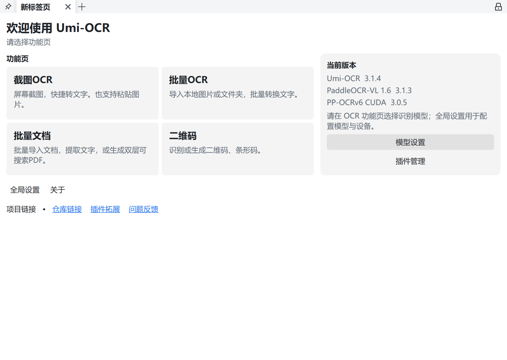
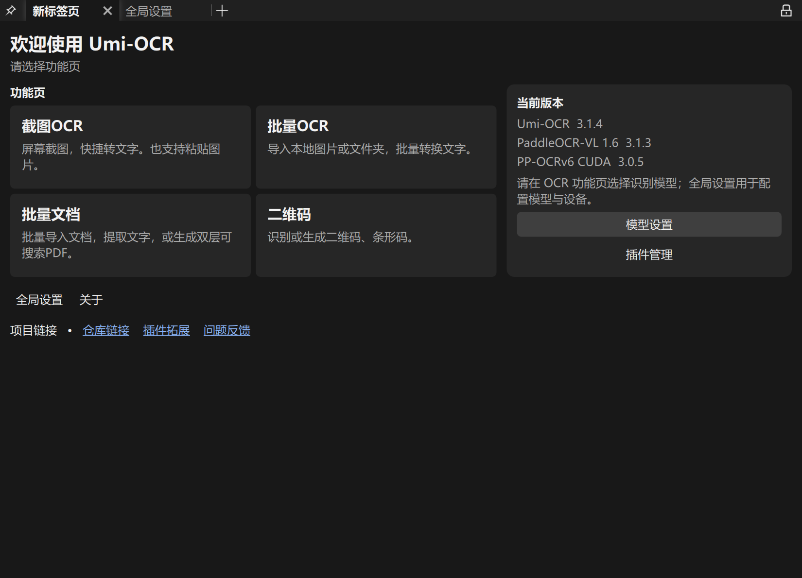
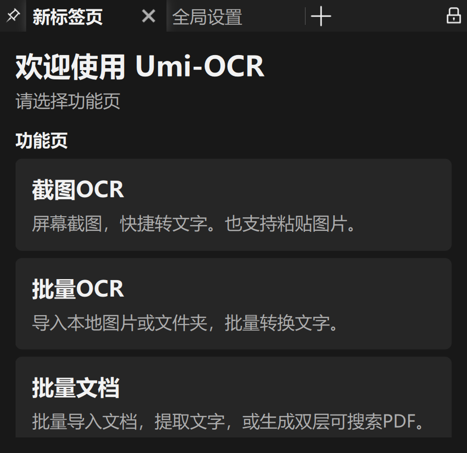
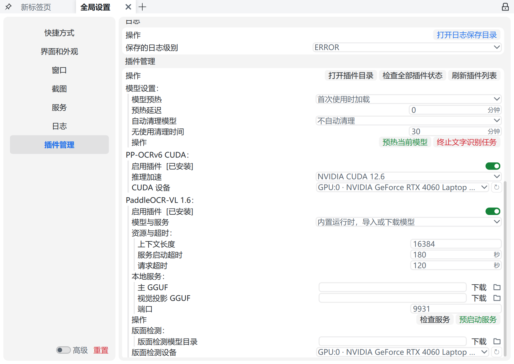
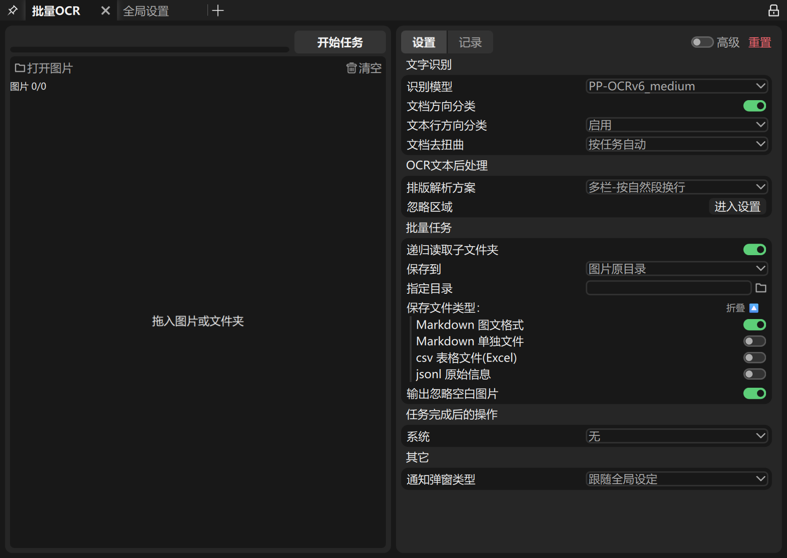

# 3.1.4 候选界面与功能展示

这些图片来自 **3.1.4 本地候选的真实 Qt 窗口**，不是设计稿、重绘结果或上游 2.0 界面。主程序与插件分别显示版本：CUDA 3.0.5、PaddleVL 3.1.3 不因主程序更新而改号。公开发行状态见[主 README](../README.md)。

本轮将源码运行与包内验收分别记录：图片所示为隔离源码沙盒，借用已核对的 Python 3.13.16／Qt 6.11.2 依赖；最终包内／归档重装结论以本轮验收记录为准，不能仅凭图片判断通过。沙盒没有用户配置和原始文档，不下载或加载模型，不触发屏幕捕获。应用字号为 100% 的图片不代表 Windows 显示缩放必为 100%。

## 功能工作台

- 用途直接显示，鼠标未悬停也能区分图片 OCR、批量图片、普通文档和二维码。
- 版本区来自实际安装清单，不虚构不存在的插件，也不把“已安装”当成“模型已加载／健康检查通过”。
- “模型设置”直达插件管理中的模型与生命周期组；纯本体／禁用全部 OCR 插件时回退到插件管理。识别模型实际在 OCR 功能页选择。仅导航，不自动下载、预热或修改服务开关。
- 功能按钮支持键盘焦点和 Space 激活；长译文和较大字号可换行。

## 模型与插件设置

侧栏标记当前定位的分组，分组重建及语言切换后沿用当前活动组件，而非已销毁的旧控件。共享模型及生命周期仍使用原规范配置来源，任务中模型切换继续等待当前已接纳工作安全收尾。

主 GGUF、视觉投影和版面模型路径仍可手动导入或经确认后下载。图中空路径属于全新沙盒，**不是用户实际模型被清空**，也不表示已执行推理。具体目录、校验和取消行为见[模型获取说明](MODEL_DOWNLOADS.md)。

## 普通批量图片与文档

批量图片可导入文件或目录；普通文档页处理 PDF 等文件，支持原文提取或 OCR、适用的可搜索 PDF 输出。这两者不等于 PaddleVL 的结构化 document 任务。

默认分发不显示 PaddleVL 独立文档任务页。其引擎、模型设置和 [HTTP 结构化接口](http/api_document.md) 保留，不通过展示素材改变 UI 门控或 HTTP 鉴权边界。

## 图片来源与未展示项

- 终端不使用 2.0.0-dev 旧图表示新界面；相关旧图经引用核对后从当前文档移除。
- 真实窗口图片及运行输入、源码／依赖摘要、主题／语言／字号矩阵分别保存在本轮审计记录，不放入运行包。
- 空任务页不是识别成功样例；没有把受控回调或图片展示当成真实模型输出。
- 本轮不主动测试截图捕获、HDR、混屏／多屏，均保持 **NOT_RUN**。窗口图采集不改变这一边界。

[使用指南](USER_GUIDE.md) · [文档导航](README.md)
